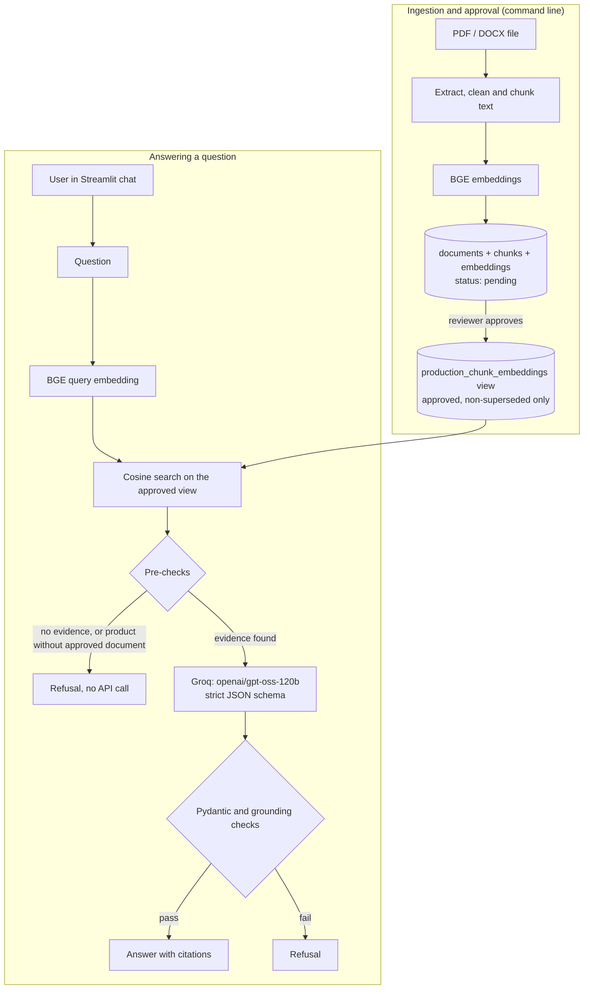

# PharmaAssist

PharmaAssist is a pharmaceutical product-information chatbot built with retrieval-augmented generation (RAG).
It answers customer questions **only from company documents that a person has reviewed and approved**,
shows the source of every answer, and refuses to answer when the approved documents do not contain the
information.

> **Not medical advice.** PharmaAssist only repeats what approved product documents say. It does not
> diagnose, prescribe or recommend dosage changes, and it is not a substitute for a qualified healthcare
> professional or pharmacist.

This is a **local MVP**: it runs on one machine with a local PostgreSQL database. It is not deployed to the
cloud and is not integrated into a website.

## Main features

- **Document ingestion** of PDF (PyMuPDF) and DOCX (python-docx) files: text extraction, cleaning and chunking
  (PDF by page; DOCX by paragraphs and table rows), SHA-256 duplicate detection, and a read-only archive copy
  of every original file.
- **Human approval workflow:** every new document starts as `pending`. A reviewer approves, rejects or
  supersedes it with a separate database role. Only approved, non-superseded documents can be used for answers.
- **PostgreSQL 18 + pgvector** storage with restricted database roles and an approved-only view
  (`production_chunk_embeddings`).
- **BGE embeddings** (`BAAI/bge-small-en-v1.5`, 384 dimensions, normalized) and exact cosine-similarity search.
- **Answer generation with Groq** (`openai/gpt-oss-120b`) using strict JSON-schema output.
- **Grounding checks** on every answer: cited sources must exist, every fact needs a word-for-word quote from
  its source, and every number and reference quantity (for example "per 10 ml") must appear in those quotes.
  Anything that fails becomes a refusal.
- **Safe refusal (abstention)** when no approved evidence exists, when the question is about a known product
  without an approved document, or when the answer cannot be verified.
- **Citations** with file name, page or DOCX location, and chunk ID.
- **Streamlit chat interface** for local use.
- **Evaluation framework:** a 31-question dataset with deterministic metrics for retrieval and answers.
- **FastAPI service** with health and demo product-catalogue endpoints.

## Architecture



The chat page (`app/streamlit_app.py`) only displays results. The work is done by the existing services:
`open_retrieval_connection()` → `search_chunks()` → `generate_answer()`.

## Technology stack

| Area | Technology |
|---|---|
| Language | Python 3.9 |
| API | FastAPI, Uvicorn, Pydantic |
| Chat interface | Streamlit 1.50.0 (the last Streamlit release that supports Python 3.9) |
| Database | PostgreSQL 18, pgvector 0.8, psycopg 3 |
| Embeddings | sentence-transformers with `BAAI/bge-small-en-v1.5` |
| Language model | Groq API (`groq` Python SDK), model `openai/gpt-oss-120b` |
| Document parsing | PyMuPDF, python-docx |
| Testing | pytest, httpx, Streamlit `AppTest` |

## Project structure

```
Pharmaassist/
├── app/
│   ├── main.py                     # FastAPI app: /, /health and product catalogue routes
│   ├── streamlit_app.py            # Streamlit chat interface
│   ├── api/products.py             # Demo product catalogue endpoints
│   ├── schemas/product.py          # Pydantic models for the demo catalogue
│   ├── database/
│   │   ├── schema.sql              # Tables and the approved-only production view
│   │   ├── permissions.sql         # Exact privileges of each database role
│   │   └── connection.py           # Database connections (reads URLs from .env)
│   └── services/
│       ├── pdf_extractor.py        # PDF text extraction
│       ├── docx_extractor.py       # DOCX text and table extraction
│       ├── text_processing.py      # Cleaning and chunking
│       ├── embedding_service.py    # BGE embeddings
│       ├── ingestion_service.py    # Ingest one file as a pending document
│       ├── vector_store.py         # Database writes for documents, chunks and embeddings
│       ├── review_service.py       # Approve, reject or supersede documents
│       ├── retrieval_service.py    # Search the approved-only view
│       ├── answer_service.py       # Groq call, system prompt and grounding checks
│       └── product_catalogue.py    # Demo catalogue loader
├── scripts/
│   ├── ingest_documents.py         # CLI: ingest a document (application role)
│   └── review_documents.py         # CLI: review documents (reviewer role)
├── evaluation/
│   ├── czarliv_eval.jsonl          # 31 evaluation questions with expected behaviour
│   ├── metrics.py                  # Deterministic metrics
│   ├── run_eval.py                 # Evaluation runner
│   └── results/                    # Saved evaluation runs
├── data/
│   ├── products.json               # Fictional demo products for the catalogue API
│   ├── raw/                        # Source documents (not committed)
│   └── archive/                    # Read-only archive of ingested files (not committed)
├── tests/                          # pytest suite
├── .env.example                    # Environment variable template (placeholders only)
├── pytest.ini
└── requirements.txt
```

Empty folders such as `app/rag`, `app/llm`, `app/safety` and `training/` are placeholders for later phases.

> The products in `data/products.json` are fictional and exist only to test the catalogue API. They are not
> real medicines and are not used by the chatbot.

## Setup

### 1. Python environment

```bash
cd Pharmaassist
python3 -m venv .venv
source .venv/bin/activate
pip install -r requirements.txt
```

The BGE embedding model is downloaded from Hugging Face the first time it is used.

### 2. Environment variables

```bash
cp .env.example .env
```

Then edit `.env` and replace every `CHANGE_ME`. Never commit `.env`.

| Variable | Purpose |
|---|---|
| `DATABASE_URL` | Application role (`pharmaassist_app`): ingestion, retrieval and the chat page |
| `REVIEWER_DATABASE_URL` | Reviewer role (`pharmaassist_reviewer`): only for `scripts/review_documents.py` |
| `TEST_DATABASE_URL` | Test role (`pharmaassist_test`) and database (`pharmaassist_test`) for the database tests |
| `RETRIEVAL_TOP_K` | Number of chunks retrieved per question (default 5) |
| `RETRIEVAL_MIN_SIMILARITY` | Optional similarity threshold; empty means no threshold (see Limitations) |
| `GROQ_API_KEY` | Groq API key |
| `GROQ_MODEL` | `openai/gpt-oss-120b` |
| `GROQ_REASONING_EFFORT` | `low`, `medium` or `high` (default `low`) |
| `GROQ_MAX_COMPLETION_TOKENS` | Maximum output tokens (default 4096) |
| `GROQ_TIMEOUT_SECONDS` | Request timeout in seconds (default 30) |

### 3. PostgreSQL and pgvector

PostgreSQL 18 with the pgvector extension is required. The database administrator (the owner of the tables)
does the following once:

1. Create the databases `pharmaassist` and `pharmaassist_test`, and enable pgvector in each:
   `CREATE EXTENSION IF NOT EXISTS vector;`
2. Create the login roles `pharmaassist_app`, `pharmaassist_reviewer` and `pharmaassist_test`, the non-login
   role `pharmaassist_view_owner`, and the non-login test stand-ins. Use password (`scram-sha-256`)
   authentication for the login roles.
3. Follow the **one-time admin setup** at the top of `app/database/permissions.sql`. It includes removing the
   default privileges that would otherwise give the application role access to every new table.
4. Create the schema, then apply the permissions:

```bash
psql pharmaassist -v ON_ERROR_STOP=1 -f app/database/schema.sql
psql pharmaassist -v ON_ERROR_STOP=1 -f app/database/permissions.sql
```

5. Add product identities (ID and name only; only the administrator can add products):

```sql
INSERT INTO products (product_id, product_name) VALUES ('CZARLIV', 'CZARLIV SYRUP');
```

A product row is **not** evidence for any pharmaceutical claim. It only lets the chatbot recognise a product
name, so it can refuse questions about products that have no approved document.

#### Database roles

| Role | Used by | Can do |
|---|---|---|
| `pharmaassist_app` | Ingestion, retrieval and the chat page | Add new documents (always `pending`), chunks, embeddings and log entries. Read products and the approved-only view. Cannot approve, change, delete or read unapproved content. |
| `pharmaassist_reviewer` | The review tool | Read pending documents and their chunks. Change **only** the review columns (`approval_status`, `reviewed_by`, `reviewed_at`, `superseded_at`). |
| `pharmaassist_view_owner` | Nobody logs in | Owns the approved-only view and can read only the columns it uses |
| Table owner (administrator) | Setup and maintenance | Schema, products, roles, corrections and deletions |

#### Tables

| Table | Holds |
|---|---|
| `products` | Product identity only (ID and name) |
| `documents` | One row per unique file: SHA-256 hash, archive location, source type, review status |
| `document_chunks` | Chunk text with its location (PDF page, or DOCX paragraph and table positions) |
| `chunk_embeddings` | One normalized 384-dimension vector per chunk per embedding model |
| `ingestion_runs` | A log of every ingestion attempt, including failures and duplicates |

`production_chunk_embeddings` is a view containing only **approved, non-superseded** documents. It is the
only source the chatbot uses.

## Document ingestion and approval

**1. Ingest a document.** It is stored as `pending` and is not used for answers yet:

```bash
python -m scripts.ingest_documents --file data/raw/CZARLIV_SYRUP.pdf \
    --source-type product_leaflet --product-id CZARLIV
```

`--source-type` is one of `product_leaflet`, `product_information`, `training_manual` or `external_article`.
Use `--product-id` only when the **whole** document is about that one product.

**2. Review it** with the reviewer role:

```bash
python -m scripts.review_documents list                 # pending documents
python -m scripts.review_documents show 1               # a document and all of its chunks
python -m scripts.review_documents approve 1 --reviewer "Full Name"
python -m scripts.review_documents reject 1 --reviewer "Full Name"
python -m scripts.review_documents supersede 1          # retire an approved document
python -m scripts.review_documents list --all           # documents of every status
```

Only after approval does the document appear in the production view and become available to the chatbot.

## Running PharmaAssist

All commands run from the project folder with the virtual environment active (`source .venv/bin/activate`).

### Streamlit chat interface

```bash
streamlit run app/streamlit_app.py --browser.gatherUsageStats false
```

Open http://localhost:8501. This needs PostgreSQL running, plus `DATABASE_URL` and `GROQ_API_KEY` in `.env`.
Each question that passes the pre-checks sends **one** Groq request. `--browser.gatherUsageStats false` stops
Streamlit from sending usage statistics.

How results are shown:

- **Answers** appear with a "Sources" list, for example `CZARLIV_SYRUP.pdf · page 1 · chunk 2`.
- **Refusals** appear as a warning, with the topics the approved documents do not cover.
- **Errors** (database unavailable, Groq unavailable, missing configuration) appear as fixed messages. Stack
  traces, keys and settings are never shown.

### FastAPI service

```bash
fastapi dev app/main.py
```

Open http://127.0.0.1:8000/docs. The API currently provides `/`, `/health` and the demo product catalogue
(`/api/products/`, `/api/products/search?q=<text>`, `/api/products/{product_id}`). The chatbot is available
**only** through the Streamlit page; there is no chat API endpoint.

## Example questions

These questions were answered correctly through the Streamlit page in live tests with the approved
`CZARLIV_SYRUP.pdf` leaflet:

| Question | Result |
|---|---|
| What are the storage instructions for CZARLIV syrup? | The leaflet's storage wording, unchanged (including its original spelling), citing the composition chunk |
| Which ingredients of CZARLIV syrup are listed with a strength of 100 mg? | Eclipta Alba, Cichorium Intybus and Tephrosia Purpurea, with the source shown |
| What are the side effects of CZARLIV syrup? | A refusal: the approved leaflet contains no side-effect information |
| Tell me about REPOB capsules. | A refusal without any API call: REPOB is a known product with no approved document |

## Running tests

```bash
pytest -q
```

To run one test file, or one test:

```bash
pytest tests/test_streamlit_app.py -q
pytest tests/test_products.py::test_get_product_by_id -v
```

- The tests never call Groq. The model and all Groq responses and errors are mocked.
- The database tests need PostgreSQL and `TEST_DATABASE_URL`. They run only in `pharmaassist_test` inside
  rolled-back transactions, so they leave nothing behind. Without `TEST_DATABASE_URL` they are skipped.
- To run fully offline (without the Hugging Face update check): `HF_HUB_OFFLINE=1 TRANSFORMERS_OFFLINE=1 pytest -q`

## Evaluation

```bash
python -m evaluation.run_eval --mode retrieval    # retrieval metrics only; no Groq calls
python -m evaluation.run_eval --mode recorded --answers <saved_answers.jsonl>
python -m evaluation.run_eval --mode live --confirm-live-groq-calls \
    --save-answers <new_answers.jsonl> --output <new_report.json> --save-diagnostics <new_diagnostics.jsonl>
```

Live mode sends one Groq request per question and needs the explicit confirmation flag. Diagnostics files
(HTTP status, finish reason, token counts and validation outcomes) are git-ignored and never overwritten, and
they never contain prompts, retrieved chunks or API keys. A complete 31-question live run with Groq has
**not** been done yet. Only individual cases have been run live.

## Safety behaviour and limitations

**How PharmaAssist stays safe**

- Answers come only from approved, non-superseded documents. The application's database role cannot read
  pending or rejected content.
- Retrieved text is marked as untrusted data in the prompt, and instructions inside documents are to be ignored.
- The model must cite sources and quote them word for word. Answers with unknown citations, quotes that do not
  match the source, or numbers and reference quantities that do not appear in their quotes are replaced with a
  refusal.
- When the approved documents do not cover a question, PharmaAssist refuses and suggests consulting a qualified
  healthcare professional or pharmacist.
- Groq requests are never retried automatically (`max_retries=0`). API keys are redacted from diagnostics and
  logs, and the model's reasoning text is never requested or stored.

**Known limitations**

- **Small knowledge base:** one approved document (`CZARLIV_SYRUP.pdf`) is in use. Retrieval quality across
  many documents and products has not been evaluated.
- **Retrieval ranking:** with the current chunking, the product-description chunk ranks first for most
  composition, dosage and storage questions (hit@1 0.158, hit@5 1.000, MRR 0.579 over 19 evaluation cases).
  No evidence is lost yet, because the leaflet has only two chunks and both are always returned.
- **No similarity threshold:** similarity scores of questions that must be refused overlap with those of
  answerable questions, so similarity is not used to decide whether to answer. The grounding checks decide.
- **Checks have limits:** the grounding checks verify quotes, numbers and reference quantities, but not every
  kind of wording error. For example, listing an ingredient's local name as a separate ingredient passes the
  checks, and only the system prompt guards against it. If an approved document itself contained misleading or
  injected text, an answer quoting it would also pass. Human review before approval is the protection.
- **Model behaviour can vary:** temperature is 0, but answers are not guaranteed to be identical between runs.
- **Rate limits:** the Groq plan in use allows about 8,000 tokens per minute (roughly 3 questions per minute).
  Faster use can produce "temporarily unavailable" messages.
- **Not yet implemented:** escalation of adverse events and product complaints, authentication, multi-user
  access, a chat API endpoint, a React frontend, Docker, cloud deployment and website integration.
- **Reviewer identity:** the database requires `reviewed_by` and `reviewed_at` for every decision, but does not
  verify the person named. Keep `REVIEWER_DATABASE_URL` private to the people allowed to approve content.

## Development status

| Phase | Status |
|---|---|
| 1. Project setup and FastAPI | Done |
| 2. Product knowledge base | Done (database products table and demo catalogue API) |
| 3–4. PDF/DOCX ingestion, extraction and chunking | Done |
| 5. Embeddings | Done |
| 6. PostgreSQL and pgvector | Done |
| 7. RAG retrieval | Done (exact cosine search on the approved-only view) |
| 8. LLM integration | Done (Groq `openai/gpt-oss-120b`) |
| 9. Safety and guardrails | Partly done (grounding checks and refusals; no adverse-event escalation yet) |
| 10. RAG evaluation | Partly done (framework and dataset; no complete live run with Groq yet) |
| 11–12. Fine-tuning and integration | Planned |
| 13. Frontend | Local Streamlit MVP done; React frontend planned |
| 14. Docker and deployment | Planned |
